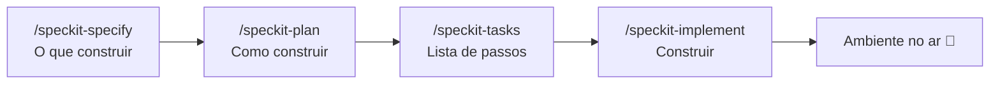

# 🛤️ Golden Path

**Descreva o que você quer. A IA constrói do jeito certo, na primeira vez.**

O Golden Path é um repositório que ensina a IA a criar aplicações com o padrão da casa: mesma stack, mesmas regras, mesmo ambiente. Você não precisa ser desenvolvedor. Conversa em português, aprova cada etapa e vê a aplicação rodando no seu computador.

```text
 💬 Você descreve        📋 A IA especifica       🏗️ A IA planeja        ✅ A IA constrói
 "quero uma lista   →    o que será feito    →    como será feito   →   e sobe tudo no ar
  de tarefas"            (você aprova)            (você aprova)         em http://localhost:3000
```

---

## ✨ Por que existe

| Sem o Golden Path | Com o Golden Path |
|---|---|
| Cada app nasce com uma stack diferente | Stack padrão: React, Node e PostgreSQL |
| "Funciona na minha máquina" | Tudo roda em Docker, igual para todo mundo |
| A IA improvisa e muda de ideia no meio | A IA segue guias e passos escritos pelo time |
| Código antes de entender o pedido | Especificação aprovada antes de qualquer código |
| Medo de apagar o banco sem querer | Comandos perigosos exigem confirmação explícita |

---

## 🚀 Começando em 3 minutos

**Você precisa de:** [Docker Desktop](https://www.docker.com/products/docker-desktop/) instalado e aberto, e o [Claude Code](https://docs.anthropic.com/en/docs/claude-code/setup).

1. Abra este projeto no Claude Code.
2. Digite `/subir-ambiente`.
3. Acesse a tela em **http://localhost:3000** e a API em **http://localhost:4000/health/ready**.

Para desligar sem perder os dados: `/parar-ambiente`.

---

## 🧭 Como criar algo novo

Toda aplicação ou funcionalidade nova passa pelo **Spec Kit**, na ordem abaixo. Você aprova cada etapa antes de a IA seguir.



Você não precisa decorar os comandos: se não digitar nenhum, a IA conduz o fluxo sozinha. Detalhes em [SPECKIT.md](SPECKIT.md).

Só correções pequenas (um texto, uma cor, um bug simples) podem ser pedidas direto.

---

## 🧱 O que vem de fábrica

```text
golden-path/
├── frontend/react/      Tela: React + Vite + Tailwind
├── backend/node/        API: Node.js + TypeScript + Prisma (há também guia para Python, sem esqueleto)
├── database/postgres/   Banco: PostgreSQL com migrations
├── infrastructure/docker/  Docker Compose e guias de ambiente
├── templates/           Cópias dos modelos (geradas; não edite)
├── scripts/             Verificações e sincronização dos templates
├── specs/               Especificações de cada funcionalidade
└── .specify/            Regras do projeto (constituição) e Spec Kit
```

Cada pasta traz um **guia** (as regras daquela tecnologia) e **skills** (o passo a passo de cada tarefa). A IA lê só o que o pedido exige.

| Quero... | A IA abre |
|---|---|
| Uma tela | [frontend/FRONTEND.MD](frontend/FRONTEND.MD) |
| Um endpoint | [backend/BACKEND.md](backend/BACKEND.md) |
| Uma tabela | [database/DATABASE.md](database/DATABASE.md) |
| Rodar o ambiente | [infrastructure/docker/DOCKER.md](infrastructure/docker/DOCKER.md) |

---

## 📅 Escala (módulo M4)

Primeira funcionalidade construída sobre o Golden Path: cadastro por planilha, diagnóstico da escala frente às regras de 42h e 40h (EC 141/2026), grade da semana, simulações, comparação e aprovação. Especificação, plano e tarefas em [specs/001-escala](specs/001-escala/).

- **Cadastros:** baixe a planilha modelo, preencha e importe. O horário da loja é cadastrado dia a dia (segunda a domingo: aberta ou fechada, abertura e fechamento, ou 24 horas) e há o atalho "Loja 24 horas". Planilhas antigas, com só semana, sábado e domingo, continuam sendo entendidas. Planilhas fora do modelo também funcionam: o sistema sugere o que entendeu de cada coluna e só grava depois da sua confirmação.
- **Loja completa em um só lugar:** a configuração da loja tem nome, CNPJ (validado), cidade, UF, bandeira, regime tributário (Simples Nacional, Lucro Presumido ou Lucro Real, só informativo) e o horário dia a dia. O dono também informa o **faturamento médio** de cada dia da semana, o mensal e a margem bruta média; gestor e consulta nem recebem esses valores. Ao editar uma loja, a **equipe** aparece abaixo, com busca por nome ou cargo, e dá para adicionar, editar e remover funcionários ali mesmo: nome, matrícula, cargo, função de escala, CPF (validado, único na loja e mascarado para quem só consulta), carga mensal (220 h = 44 h por semana, 210 h = 42 h, 200 h = 40 h) e horário de entrada e saída atuais com os dias trabalhados.
- **Venda do Diagnóstico sem base comercial:** a base comercial é opcional. Sem ela, o Diagnóstico usa o faturamento cadastrado na loja, dividido igualmente entre as horas abertas de cada dia, e avisa que é estimativa (não há "horário de maior venda" nesse caso). Com a base, ela vale no lugar do cadastro. O horário digitado no cadastro da equipe completa a escala atual de quem não está na escala importada; a escala importada sempre vale mais.
- **Escala:** envie a escala atual e as vendas por hora, veja o diagnóstico, monte simulações arrastando os turnos, compare até 3 e aprove a que fica em uso (só o dono do grupo aprova).
- **Vagas e custo:** na simulação em rascunho dá para adicionar vagas simuladas e desligamentos (nada chega ao cadastro). O dono informa o salário médio por função e os encargos em Configuração, e a comparação mostra custo mensal, anual e a diferença frente à simulação em uso. Gestor e consulta não recebem valor de custo.
- **Cenários de decisão:** abaixo do quadro central do Diagnóstico há cinco cenários, para 42h ou 40h (o seletor do quadro troca todos): **1 · Manter horários**, **2 · Sem contratações**, **3 · Equilíbrio**, **4 · Abrir um dia hoje fechado** e **5 · Reduzir equipe** (quantas pessoas por cargo excedem o que o horário atual exige, com a economia de folha, como capacidade excedente para a gestão avaliar, sem validação trabalhista). O dono vê o custo, o impacto por mês e o selo "Menor impacto financeiro" (entre os cenários 1 a 3); gestor e consulta não recebem valor em reais. São estimativas: nada altera o cadastro nem cria funcionário. Os cenários 4 e 5 não entram no selo. Detalhes do cálculo no item seguinte.
- **Cadastros reúne o que a Escala precisa para simular:** duas seções: "Lojas" (o painel de Cadastro de loja, descrito abaixo) e "Parâmetros legais" (regras de 44h, 42h e 40h com versões). A Escala fica só com "Diagnóstico" e "Simulações".
- **Importação em massa (spec 014):** a tela **Cadastro de Loja** tem um só botão, **Importar em massa**. Ele abre o modal com o botão "Baixar planilha modelo" e o envio do arquivo (.xlsx ou .csv); antes de gravar, o sistema mostra o que entendeu das colunas. O modelo tem duas abas para preencher: **Lojas** (dados, horário por dia, loja 24 horas, faturamento e margem, convenção de 8h24, meta de pessoas por hora de cada função, salário médio por função e encargos) e **Funcionários** (dados da equipe e **Horário fixo**), mais a aba de ajuda "Como preencher". Cada campo do cadastro de loja e de funcionário tem uma coluna no modelo. **Quem importa o quê:** o operador cria e atualiza lojas; o dono atualiza as lojas que já existem (horário, faturamento, margem, convenção, metas e custos), mas não cria loja nem muda código ou CNPJ; o gestor importa só a equipe (a aba Lojas é ignorada com aviso). Faturamento, margem, salário e encargos só o dono grava. **Coluna em branco mantém o que já está cadastrado** (vazio nunca apaga) e planilhas antigas, sem as colunas novas, continuam funcionando. Metas e salários são mesclados com o que a loja já tem; salário sem encargos não grava custo e o resumo avisa. O resumo mostra criados, atualizados, avisos e as linhas com erro (aba, linha e motivo). Especificação em [specs/014-importacao-em-massa](specs/014-importacao-em-massa/).
- **Encargos da folha por regime tributário (spec 015):** o encargo não é mais um percentual digitado: vem do **regime tributário da loja** (Simples Nacional, Lucro Presumido ou Lucro Real). Cada regime guarda os componentes (INSS patronal, RAT × FAP, terceiros, FGTS, 13º, férias + 1/3 e, se ligada, a provisão de rescisão) e o total é calculado: `diretos + provisões + (provisões × diretos) + rescisão`. Com os padrões, o Simples dá cerca de 29,0% e o Presumido e o Real cerca de 62,2% (Real e Presumido têm os mesmos encargos de folha). O total vale na folha atual, no custo das contratações, na hora extra, nos cenários e nas simulações. Os componentes ficam em **Parâmetros legais › Encargos por regime**, com data de início de vigência e versões (só o dono altera; alterar cria uma versão nova). Loja **sem regime** usa o Lucro Presumido e mostra o alerta "Não encontramos o regime tributário da loja…", com o seletor para escolher o regime na hora. Em **Custos** o dono ajusta, por loja, **RAT** (1% a 3%), **FAP** (0,5 a 2,0) e a **provisão de rescisão**, com "Restaurar padrão"; o card da folha mostra "Salários + encargos {total}% ({regime})" e "Ver composição". Na planilha de importação, a coluna "Encargos (%)" foi trocada por "RAT (%)", "FAP" e "Provisão de rescisão (Sim/Não)"; a coluna antiga ainda é lida, mas ignorada com aviso. Percentuais de referência: confirme com seu contador. Antes e depois da folha em [specs/015-encargos-por-regime/antes-depois-folha.md](specs/015-encargos-por-regime/antes-depois-folha.md).
- **Card "Diagnóstico da escala" (versão compacta):** no topo da aba Diagnóstico, as abas **Regra de 44h / 42h / 40h** (com "em vigor hoje" e a data de início) trocam o card inteiro. O card responde primeiro à pergunta "quanto falta de farmacêutico e o que faço?": pill de status, título ("Faltam 14h de farmacêutico por semana"), texto de apoio com o prazo ("daqui a 47 dias", ou em meses acima de 60 dias, pela data em São Paulo), três barras que comparam o gap de 44h, 42h e 40h, e quatro números de apoio (contratações sugeridas, turnos de farmacêutico a cobrir, a **folha mensal atual** com os encargos do regime, e a equipe toda; a composição dos encargos aparece numa dica "i" no quadro da folha, ao passar o mouse, focar com o teclado ou tocar). No rodapé ficam as pendências (colaborador sem função de escala, horas sem farmacêutico, abaixo da meta, linhas rejeitadas) e o link para enviar a base comercial; sem pendências aparece a frase "Sem pendências em cobertura, metas e importação.". Cinco estados: falta na regra em vigor, falta numa regra futura, cobertura completa, sem cálculo e regra já em vigor. As abas funcionam com as setas do teclado. Os cinco cartões de "Pontos de atenção" saíram: os valores continuam como dica na frase do rodapé.
- **Diagnóstico: "Cobertura atual da equipe" (antes "De onde vêm esses números") em 3 abas (spec 018):** abaixo dos Cenários, os blocos antigos (Quadro por turno, Cobertura da escala atual, Horários de maior venda, Quadro por função, Verificação por regra e Escala atual por colaborador) viraram **um cartão com 3 abas**, que abre em "Cobertura e vendas" e guarda a aba no endereço (`?tela=escala&aba=cobertura|regras|equipe`), com teclado e leitor de tela. **Cobertura e vendas:** uma grade única por hora com os turnos (recortados ao horário da loja; os sobrepostos ficam em linhas separadas), as vendas médias por dia (picos = venda ≥ 75% do maior valor, em azul escuro; quem não é dono vê a participação em %, não R$) e as pessoas por função no pior dia (▲ e rótulo quando abaixo do mínimo; hora fora do horário da loja listrada e sem mínimo). A observação "No pico de vendas… há N atendentes. As M pessoas só aparecem entre …" só aparece quando o maior número de atendentes está fora do pico; "Vendas fora do horário" só quando existe venda fora do horário cadastrado; links levam ao Cadastro na loja e aba certas. **Resultado por regra:** uma tabela com 44h, 42h e 40h (capacidade, "sobram/faltam Xh", barra com escala comum por função, "Atende" ou "Falta …"); a coluna da regra escolhida no topo fica destacada; o bloco "E se a convenção coletiva permitir 8h24 por dia?" só aparece com a convenção desligada e quando a estimativa reduz o que falta (a estimativa vem do servidor, `regras[r42].com8h24`, com a mesma verificação de capacidade). **Equipe no cálculo:** somente leitura, por função, com totais, situação ("No cálculo"/"Fora do cálculo"), linha do tempo do turno (parte fora do horário listrada) e atalhos para o Cadastro. **Depois, por decisão da pessoa, também saíram da página "Escala redistribuída" e "Déficit e contratações por função"** (que eu tinha mantido porque a redistribuição, os "dias e horários que cobrem o descoberto" e a alternativa de parcial com hora extra só existiam neles; essas contas continuam sendo feitas no servidor, só não aparecem na tela, e o botão "Simular esta contratação" saiu junto). Especificação, plano, tarefas e relatório em [specs/018-diagnostico-de-onde-vem](specs/018-diagnostico-de-onde-vem/).
- **Cadastro de loja em painel único (spec 017):** uma tela só, com a **lista de lojas** à esquerda (busca por nome, código ou CNPJ; filtros "Cadastro: Completo/Revisar" e "UF"; "Ver mais"; seleção por clique ou setas) e a **loja escolhida** à direita, em 3 abas, no mesmo cartão. Abaixo de ~1100 px viram duas telas, com "← Voltar para a lista". A loja e a aba ficam no endereço (`?tela=cadastros&loja=…&aba=…`; nada sensível), então recarregar volta ao mesmo lugar. **Completo ou Revisar** é calculado no servidor (`situacaoDoCadastro`, uma função só): dados básicos (nome, cidade, UF, regime), funcionamento definido, ao menos 1 farmacêutico, faturamento em todos os dias abertos e mensal dentro de 10% da soma dos dias; o detalhe mostra o motivo em texto, sem valores em reais. **Dados e funcionamento:** dados da loja e uma tabela com uma linha por dia (aberta/fechada, abre, fecha, 24h, faturamento médio só para o dono, horas), "Loja 24 horas", "Copiar horário da segunda" (só o horário) e o resumo por mês (mensal informado, soma dos dias × 52 ÷ 12, margem) com o alerta de 10% e "Usar R$ …". **Equipe:** cada ação grava na hora (aviso, remover com confirmação e "Desfazer"), CPF mascarado, "Fora do cálculo", "Importar equipe". **Regras e custos:** custos e encargos recolhidos (só o dono), convenção com a chave "Não permite / Permite" e o **Mínimo de pessoas** por turnos (barra com sobreposição e faixas fora do horário, cartões de turno, farmacêutico sempre ≥ 1) ou mínimo único do dia; trocar de modo não apaga o outro. **Um só "Salvar alterações"** grava dados, funcionamento, faturamento, regras e custos de uma vez (`PUT /lojas/:id/painel`: valida tudo antes e grava numa única atualização), com contador de alterações, "Cancelar" e aviso ao sair com alterações. O operador cadastra loja pelo modo "Nova loja" (Equipe e Regras ficam bloqueadas até a primeira gravação). **Regras novas de turno no servidor:** turnos podem se sobrepor e começar antes da abertura ou terminar depois do fechamento; o mínimo só conta dentro do horário de funcionamento; onde dois turnos se sobrepõem vale o **maior** mínimo por cargo (não soma); horas sem turno viram aviso ("Sem turno entre 17:00 e 18:00", valendo 1 farmacêutico e o nível de hoje nos demais), não erro; o modo "turnos" ou "único" fica guardado no JSON de turnos (sem migration). Fora do desenho novo e por isso removidos: o botão "Remover loja" da lista antiga e o formulário "Editar loja" em página inteira. Especificação, plano, tarefas e relatório em [specs/017-cadastro-loja-painel](specs/017-cadastro-loja-painel/).
- **Folha e faturamento no quadro do Diagnóstico (só o dono):** a célula "Folha mensal atual" mostra quanto a folha pesa, em %, no faturamento mensal da loja, e uma célula nova, "Faturamento mensal da loja", mostra o valor e de onde ele vem (informado no Cadastro; soma da venda por dia × 52 ÷ 12; ou a base comercial × 52 ÷ 12, nessa ordem). Sem faturamento, aparece "Sem faturamento para comparar". Gestor e consulta não recebem nenhum dos dois campos (`faturamentoMensal` e `folhaMensal.pctDoFaturamento`).
- **Só contratação integral (spec 044):** o sistema não sugere nem cria mais contratação parcial. O motor devolve `ceil(falta ÷ jornada cheia)` pessoas integrais (a jornada cheia da regra: até 44h, 40h nas regras de 42h e 40h sem convenção), as horas que sobram da última pessoa aparecem como ociosas e o custo de pessoal sobe de acordo; a variante de 26h com horas extras e o aviso do CRF para parcial saíram, e a premissa "limite do parcial" não tem efeito. O "+ Contratar" da Escala por hora só cria vaga integral (dias e horário sugeridos continuam). O servidor recusa vaga **nova** com carga diferente da jornada cheia ("A contratação é integral: N horas por semana nesta regra."); vagas que já existem em simulações salvas continuam abrindo como estavam. O cenário Equilíbrio só corta horas do sábado ou do domingo quando isso evita uma pessoa integral inteira.
- **Intervalo de até 2 horas não precisa de cobertura (spec 045):** para qualquer função (Farmacêutico, Atendimento e Caixa), a pessoa em intervalo de até 2 horas continua contando como presente na hora; acima de 2 horas o intervalo desconta como antes. O critério é um só (`regras/intervalo.ts` no servidor e `intervaloSemCobertura` na tela) e vale na avaliação da Simulação, na cobertura do Diagnóstico, na distribuição do parcial, na conta real dos cenários e no recálculo ao arrastar um turno. A barra do turno continua mostrando o trecho do intervalo, com a dica "não precisa de cobertura (até 2 horas)", e a célula da hora diz "Em intervalo (não precisa de cobertura): Nome". Regra de referência, ainda a confirmar com o jurídico da Farmarcas junto das outras pendências (art. 386 da CLT, regras de domingo e feriado de farmácia).
- **Esticar os turnos até o limite da regra (spec 046):** depois das folgas, a Simulação e a conta dos cenários aumentam o turno de quem trabalha menos que o limite (o menor entre a carga contratada e o teto da regra, por exemplo 42h com a convenção de 8h24), **só onde a função ainda está sem cobertura**: hora inteira por vez, no fim do turno e, se não couber, no começo, até o máximo de horas por dia, dentro do horário da loja e respeitando 11h de descanso entre os dias. Quem tem horário fixo no Cadastro e as Contratações simuladas não são esticados. Como só cobre falta, o esticamento nunca aumenta a contratação, e o cartão do cenário continua igual à Simulação aberta por Personalizar. O turno esticado guarda o horário de antes (colunas `antes_entrada` e `antes_saida` em `simulacao_turnos`, migration `20261111120000_turno_esticado_antes`), e a tela marca "ajustado" com a dica "Turno aumentado de 14h–22h para 13h–22h para cobrir a falta, dentro do limite de 42h". Regras de horas: EC 141/2026, ainda a confirmar com o jurídico.
- **Jornada cheia para todos e horas em minutos (spec 047):** na Simulação e na conta dos cenários, cada pessoa (sem horário fixo; as Contratações simuladas já nascem cheias) trabalha a **jornada cheia da regra em cada dia que já trabalha, mesmo sem falta**: `min(máximo por dia, teto ÷ dias)`, ou seja, 8h24 por dia (42h em 5 dias) com a convenção de 8h24, 8h sem ela e 7h20 na regra de 44h (6 dias), limitada à carga contratada. A fase de cobrir falta (spec 046) decide onde o turno cresce primeiro; depois a duração do dia é completada no fim do turno e, se não couber, no começo, sem passar do horário da loja nem das 11h de descanso; não cria dias. Para caber 8h24, a Simulação passou a aceitar **minutos inteiros** (15,4 = 15h24; fração de minuto é recusada) e guarda o horário do Cadastro como está (14h38 deixa de virar 14h45); arrastar continua de 15 em 15 minutos e mantém a duração do turno.
- **Cenário Equilíbrio oculto:** a tela do Diagnóstico mostra só "Manter horários" e "Sem contratações"; o Equilíbrio continua sendo calculado no servidor (a API ainda devolve a linha), só não aparece.
- **Custo de pessoal sobre o faturamento nos cenários (só o dono):** na coluna "Custo de pessoal" de cada cenário, abaixo da variação em %, aparece quanto o custo novo pesa no faturamento mensal da loja: (folha de hoje + custo adicional das contratações) ÷ (faturamento de hoje + variação da venda do cenário), com "hoje" ao lado (a folha atual ÷ o faturamento de hoje). Sem R$; o campo `custoPctFaturamento` só existe para o dono e fica nulo sem folha ou sem faturamento.
- **Peso do custo de pessoal no faturamento e resultado do horário estendido (specs 048 e 049):** na coluna "Custo de pessoal" de cada cenário, o dono vê "8,0% → 9,7% do faturamento", "+1,7 p.p." e "(R$ 7.659/mês)" (folha de hoje e nova ÷ faturamento mensal, aumento em pontos percentuais e em R$); o "+X% sobre a folha" saiu da tela. Gestor e consulta veem só "Aumenta", "Igual" ou "Diminui" (`custoSentido`) e não recebem nenhum campo de custo. A visão de grupo (soma das lojas) fica para uma entrega própria. No painel do Personalizar, quando o horário simulado abre horas a mais, o dono vê o bloco "Resultado do horário estendido": venda adicional estimada, CMV (por hora quando a base traz; senão o CMV médio da loja), lucro bruto, aumento de folha e resultado, com o selo azul "Recomendado" (resultado ≥ 0) ou vermelho "Não recomendado", e o modal "Como calculamos" com a conta aberta. Caso de referência: venda R$ 9.000, CMV 57,8% e folha +R$ 4.680 dão CMV R$ 5.202, lucro bruto R$ 3.798 e resultado −R$ 882 (vermelho). Só o dono recebe `resultado.horarioEstendido`.
- **Coluna "Folha no faturamento" nos cenários (spec 050):** cada linha de cenário mostra o peso da folha sobre o faturamento ("do faturamento"), o peso de hoje e uma etiqueta com a diferença ("+1,7%" âmbar, "−0,6%" verde, "folha igual" neutra), mais "R$ … a mais/menos por mês". Quando a folha fica igual mas o peso sobe, aparece "Sobe só porque a venda cai.". O dono vê o cabeçalho "Folha no faturamento"; gestor e consulta veem "Custo de pessoal" só com a etiqueta Aumenta/Igual/Diminui, sem valores. Sem salários ou faturamento, aparece uma frase pedindo a informação. A grade passa a ter seis colunas a partir de 1120 px (abaixo disso a linha empilha). O texto de abertura da tela foi atualizado.
- **Texto explicativo em cada cenário (spec 051):** abaixo da linha de **Manter horários** e de **Sem contratações** aparece uma frase curta que conduz a decisão, no lugar da faixa amarela de causa. O dono lê, por exemplo, "…a folha sobe de 8,0% para 9,7% do faturamento (R$ 7.659 por mês). Este é o caminho recomendado."; gestor e consulta leem a mesma ideia sem "R$" nem "%" ("a folha precisa aumentar"). Em Sem contratações, o trecho "Mesmo assim, ainda faltariam N h de farmacêutico por semana." vem em preto e negrito (a função de mais horas; as demais agrupadas em "outras funções"). "Caminho recomendado" só aparece quando Manter horários cobre toda a necessidade. A frase é montada no servidor (`explicacaoDaLinha`) e a coluna Folha continua mostrando os números.
- **Card "Resultado da simulação" com o peso da folha (spec 052, versão B1):** o card da Simulação passou a mostrar, lado a lado, **Venda** e **Folha no faturamento** (dono: peso depois em 22 px, chip da variação "+1,7%" âmbar / "−0,6%" verde / "folha igual", "hoje 8,0%" e os reais por mês; gestor e consulta: "Custo de pessoal" com um chip Aumenta, Igual ou Diminui). A tabela Hoje | Simulação | Mudança e o "+X% sobre a folha" saíram: entra a lista **O que muda** (Folha por mês só para o dono, Pessoas, Horas contratadas e Hora extra, que só vira item quando é maior que zero; senão "Sem hora extra."), com "antes → depois" e a variação em âmbar, verde, cor neutra ou cinza. O peso vem da mesma conta dos Cenários (`escala/peso-folha.ts`), com o mesmo faturamento de referência da loja; "hoje" conta também quem a simulação desliga. O servidor manda `custoDoDono` (peso e folha por mês) só ao dono; gestor e consulta recebem só `emHoras.custoSentido`, sem o % do custo. O bloco **Horário a mais** (só dono) virou um quadro cinza com título "Horário a mais: sábado até 23h", selo Recomendado (verde) ou Não recomendado (vermelho), "Custo da mercadoria" no lugar de CMV e o modal "Como calculamos".
- **Contratação simulada com jornada cheia (spec 053):** a vaga integral de uma simulação (por exemplo a que vem do botão Analisar) não entra mais só onde falta cobertura: depois de cobrir a falta, cada turno cresce até a jornada do dia (8h24 com a convenção, 8h sem ela) e, se sobrarem horas do contrato, entram turnos nos outros dias abertos, até os dias da regra (Cosmópolis: "42h · 5 dias" em vez de "21h · 4 dias"). Respeita o horário da loja e as 11 h de descanso; o parcial (até 30 h) continua cobrindo só a falta. Mesma ideia da spec 047, agora para a vaga nova.
- **Desligar pessoa na simulação (spec 054):** na Escala por hora, na Escala da semana e no celular, cada funcionário que já existe no quadro tem o botão **Desligar** (só com a simulação editável e para quem pode editar; vaga simulada continua com "Remover"). A pessoa sai só da simulação: continua na lista do grupo, **mais opaca** e com "Fora da simulação" e **Religar** na própria linha (grade do dia, semana e celular), fora da cobertura e do custo, e tudo é recalculado (cobertura e faltas, horas, status, Pessoas e Horas contratadas e, para o dono, a folha e o peso no faturamento do card). A faixa **"Desligados na simulação (N)"** lista quem saiu, com **Religar** ao lado de cada nome; religar devolve a pessoa com os mesmos turnos e o mesmo resultado. Os desligados ficam guardados com a simulação (continuam ao reabrir), aparecem sem os botões em simulação gravada e para consulta, e nada muda no Cadastro. Desligar o único farmacêutico é permitido e o resultado fica "Sem farmacêutico no quadro". O servidor já aceitava a lista de desligados; esta spec adiciona a tela e os testes do ciclo.
- **Folgas sugeridas mais intercaladas (spec 055):** a escolha do dia de cada folga (botão "Sugerir folgas" e simulação aberta com as folgas aplicadas) continua começando pela **cobertura** (o dia que abre menos falta nova) e passa a desempatar por: **afastar** da própria folga da pessoa (domingo e segunda contam como dias seguidos; as folgas que ela já tem no Cadastro entram na conta), **espalhar** a equipe (menos folgas da função naquele dia), mais sobra de cobertura e, por fim, um desempate **rotativo** pela posição da pessoa (em vez de "sempre o menor dia"). Sem sorteio: a mesma entrada dá a mesma sugestão, e o servidor (`escala/semana-com-folgas.ts`) e a tela (`folgas-regras.js`) dão as mesmas folgas, travado por um teste de paridade nos dois. Quando só dá para folgar colado sem faltar gente, a sugestão avisa com o nome: "Fulana: não deu para afastar as folgas sem faltar gente." O rodízio de domingo, o limite de dias da regra e as 11 h de descanso seguem valendo.
- **Botão "Analisar":** o botão do cenário que abre a Simulação passou a se chamar **Analisar** (antes, "Personalizar"); em qualquer lugar deste README que ainda diga "Personalizar" para esse botão, leia "Analisar". O comportamento não mudou.
- **Cenários lado a lado (comparação alinhada; sem selo de "cenário sugerido": nenhum cenário vem destacado e todos os botões Personalizar são iguais):** os três cartões usam uma grade com subgrid (a partir de 1200 px), então cada faixa fica na mesma altura nos três: título, pills, descrição, impacto mensal estimado (com a composição "folha adicional + margem perdida" e uma barra proporcional ao maior impacto), frase de comparação com o Cenário 1 ("R$ … a mais por mês que o Cenário 1"), contratações em chips, e as linhas Horário, Horas abertas, Vendas perdidas e Horas ociosas da equipe, com o botão **Personalizar** sempre no pé. As pills são "Cenário sugerido", "Menor impacto mensal" (só quando um cenário é o único menor), o status ("Não resolve sozinho", "Não recomendado", "Inviável") e "Mais cara que manter" (equilíbrio pior que o Cenário 1). **Personalizar** cria um rascunho de simulação a partir da escala atual com as contratações do cenário e abre a aba Simulações; o horário do cenário não vai para o simulador. Abaixo de 1200 px os cartões empilham. Quem não é dono vê tudo menos os valores em reais.
- **Clareza dos cenários (spec 019):** os nomes dos três cartões não mudam, mas cada um traz uma **premissa fixa** (1: "Contratar para cobrir a escala nos horários de hoje"; 2: "Não contratar; ajustar horários só se precisar"; 3: "A melhor combinação entre contratar e ajustar horários") e uma **linha de resultado** que muda por loja ("Contrata 2 pessoas: atendimento e apoio", "Nenhum horário precisa mudar", "Sábado fecha 5 h mais cedo…"). Quando o cenário deixa alguma função abaixo do nível de hoje, aparece uma **faixa amarela** com a falta em horas por função ("Atendimento 32 h por semana abaixo do nível de hoje · Apoio 4 h"), sem falar de venda perdida; só se o cenário reduz horários a faixa mostra venda e margem perdidas (o gerente vê as horas), e o único risco para a venda é o farmacêutico ausente (horas por semana sem farmacêutico, calculadas com os horários do cenário). O selo "Menor impacto mensal" passou a **"Menor custo"**, e o "Cenário sugerido" vai para o Cenário 1 quando o de menor custo deixa função abaixo do nível de hoje. A comparação com o Cenário 1 traz o preço da economia ("R$ 3.592 a menos por mês que o Cenário 1, com 32 h de atendimento a menos"). O Cenário 3 igual ao 1 ou ao 2 fica **recolhido** numa linha ("mesmo resultado do Cenário 1"), e a loja que já cobre tudo mostra uma frase única no lugar dos cartões. Contratações só para manter o nível de hoje aparecem como "(opcional)". Não há mudança de banco. Especificação em [specs/019-clareza-dos-cenarios](specs/019-clareza-dos-cenarios/).
- **Cenário 3 com horário estendido (spec 020):** além de cortar, o Cenário 3 também testa **estender sábado e domingo** (abrir até 3 h mais cedo e/ou fechar até 3 h mais tarde, sem abrir antes das 6h, fechar depois das 24h nem passar de 16 h abertas no dia), usando a mesma conta de contratação dos outros cenários: a folha extra que a extensão exige entra no custo e a margem das horas novas abate o impacto, que pode ficar **positivo**. A venda das horas novas é **estimativa**: vale a venda registrada nessa hora (base comercial, inclusive fora do horário cadastrado) e, onde não há registro, **50% da venda da hora vizinha** (a fração é fixa, sem painel); o cartão avisa "Venda das horas novas é estimada". Segunda a sexta continuam sem mudar. O selo "Menor custo" vira **"Melhor resultado"** quando o melhor cenário tem impacto positivo, e o "Cenário sugerido" só vai ao Cenário 3 com horas novas se o impacto continuar melhor que o dos outros cenários com **metade** da margem estimada. Quando nenhuma extensão compensa, o Cenário 3 fica como antes. A mudança não mexe em banco. Os dias da semana de maior venda ficam para uma segunda fase. Especificação em [specs/020-cenario-3-estender-horario](specs/020-cenario-3-estender-horario/).
- **Impacto em venda e saldo contra a folha (spec 022) — vale no lugar das descrições de "margem perdida" acima:** os cenários deixam de usar margem. A **venda que deixa de entrar** é a soma da venda média de cada hora fechada (por dia da semana, da base comercial) × 52 ÷ 12, mostrada por dia alterado ("Sáb até 16h: R$ X por mês") e no total; a escolha dos cortes usa a venda hora a hora, não a divisão igual do dia. O **saldo** é `economia de folha − venda perdida` (ou `venda adicional − custo adicional` quando estende), onde a economia de folha é o custo do cenário "Manter horários" menos o do cenário avaliado (salários + encargos do regime + provisões; a hora extra entra na Simulação). Saldo positivo aparece em verde com "Este cenário compensa" e negativo em vermelho com "Este cenário custa mais do que economiza"; há valor anual (× 12) e peso no faturamento mensal médio. O Cenário 1 é a base (venda perdida 0, saldo 0, mostra o custo adicional de folha). **Sem venda hora a hora** (só o faturamento por dia do Cadastro) os cortes continuam montados, mas a venda perdida e o saldo não são estimados: o cartão mostra "Sem venda hora a hora, não é possível estimar a venda perdida" (nunca R$ 0) e o Cenário 3 fica indisponível. A venda das horas novas continua estimativa, com o percentual (padrão 50% da hora vizinha) **editável** num campo acima dos cartões (vale na tela, não é gravado). O selo é "Melhor saldo" e o "Cenário sugerido" segue o saldo (o Cenário 3 com horas novas só é sugerido se resistir à metade da venda estimada). A **Simulação** mostra venda que sai, folha extra, hora extra, economia de folha (contra contratar para cobrir o horário do Cadastro com a equipe de hoje), saldo, anual e peso. A **margem bruta virou detalhe opcional** no Cadastro (não é mais pendência nem entra no "Completo") e saiu das premissas da consulta. Existe a conta pura `somarGrupo` (saldo, venda perdida, economia e venda adicional somados, com o peso sobre o faturamento total do grupo e as lojas que ficaram fora por falta de dado), sem tela. Especificação em [specs/022-impacto-venda-e-saldo](specs/022-impacto-venda-e-saldo/).
- **Novo cabeçalho e menu lateral do Radar (spec 023):** a casca da tela saiu de `App.jsx` para `frontend/react/src/shell`. Barra superior de 80 px (botão do menu, logo do Radar, conta), menu lateral aberto (280 px) ou recolhido (72 px, só ícones com dica; Minhas Lojas e Escala abrem um painel com os subitens), que lembra a escolha no navegador e vira gaveta em tela estreita. O menu é: Minhas Lojas (Lojas e, só para o operador, Parâmetros legais), Escala (Diagnóstico e Simulações) e Grupos (só operador); as abas internas dessas telas saíram. Nas telas da Escala, uma faixa de 64 px mostra as horas de funcionamento da loja, o **filtro de Loja (o único da ferramenta)** e o **Importar** (o mesmo envio de planilhas de antes, só para quem pode escrever). O menu da conta (avatar) traz papel, grupo e Sair; o bloco "Demonstração" (Grupo e Papel) aparece enquanto não há login e some com `VITE_MODO_DEMONSTRACAO=false` no build da tela. O conteúdo e os cálculos das telas não mudaram. Especificação em [specs/023-novo-cabecalho-e-menu](specs/023-novo-cabecalho-e-menu/).
- **Cartões de cenário B2 e painel "Dias e horários" (spec 024):** os três cartões do Diagnóstico (sempre Manter horários, Sem contratações e Equilíbrio) foram refeitos: faixa de resultado com o **saldo da operação por mês** em destaque (verde com "+", vermelho com "−", preto em R$ 0) e, abaixo, **custo de folha** e **venda** do mesmo tamanho; status e comparação com o Cenário 1; contratações com uma linha por contratação (letra da função, barra de horas ÷ 42, integral ou parcial); horas ociosas; e a faixa da semana com a diferença de horas de cada dia. O link **Ver todos os dias ›** abre o painel "Dias e horários" (lateral de 440 px; folha inferior no celular) com o novo horário, o de antes, a diferença e o total, com Esc, clique fora, foco preso e foco de volta ao link. O **saldo é contra a folha atual**: `(economia de folha − custo de folha) + (venda estimada − venda que deixa de entrar)`, numa função única (`saldo-operacao.ts`); soma faturamento com folha, não margem. A ordem entre os cenários e o "Cenário sugerido" não mudaram (o saldo antigo, contra o Cenário 1, continua alimentando os selos). **A validar com o produto:** a regra do saldo e "integral" (cada contratação inteira é integral; o parcial é parcial, com a barra valendo 42 h). Texto verde usa `--text-success-strong` (#3E7500). Sem o selo "Melhor saldo" e sem a lista de venda perdida por dia do cartão antigo (o detalhe por dia está no painel). Especificação em [specs/024-cartoes-de-cenario-b2](specs/024-cartoes-de-cenario-b2/).
- **Simulação compacta (spec 025):** o passo "Horário e vendas" e o painel de resultado foram refeitos. Abertura e fechamento de cada dia têm **+ e − de 1 em 1 hora** (também dá para digitar; valor inválido volta ao último válido; ↑ e ↓ no campo), com o selo "Alterado", "Fechar dia" e "Restaurar do Cadastro". Um dia fechado pela simulação mostra "Fechado nesta simulação" com **Reabrir**, e um dia fechado no Cadastro mostra "Fechado" com **Abrir dia** (abre das 08:00 às 18:00 para ajustar). O gráfico mostra as **horas fechadas listradas** (venda que deixa de entrar) e as **horas novas em verde tracejado** com a venda estimada ("+0,3"), com legenda e três resumos do dia. O **Resultado** fica à direita (360 px, fixo ao rolar) com as linhas Folha extra · Hora extra · Venda que deixa de entrar · **Venda estimada** · Economia de folha · Horas abertas. A **venda estimada** das horas novas vem do servidor (`venda-estimada.ts`), com a regra dos cenários (a registrada, ou 50% da venda da hora vizinha), agora para qualquer dia. O **saldo** é contra a folha atual, a mesma regra dos cartões: `−folha extra − hora extra + venda estimada − venda que deixa de entrar` (`saldo-simulacao.ts`); a economia de folha (contra manter o horário e contratar) virou informação e não entra na conta. **A validar com o produto:** a regra do saldo (o quadro de desenho dava −R$ 40.275 no 1º exemplo; agora dá −R$ 41.916). "Venda que sai" virou "Venda que deixa de entrar". Sem versão para celular. Especificação em [specs/025-simulacao-compacta](specs/025-simulacao-compacta/).
- **Planilha de escala aposentada (spec 026):** a equipe e os horários vêm **só do Cadastro de funcionários** (função, carga, dias, entrada, saída e, novo, **início e fim do intervalo**, na planilha de funcionários e na tela de Equipe). O Diagnóstico e a Simulação leem só o Cadastro; o intervalo desconta o almoço na cobertura por hora. O envio de planilhas ficou só com a **Base comercial** (saíram o envio e o modelo da escala, a pendência de "linhas rejeitadas na importação da escala" e os textos que mandavam importar a escala). A Simulação criada a partir de um cenário parte da equipe do Cadastro; sem funcionário com horário, cai em "do zero" com o aviso novo (código de erro `SEM_HORARIO_NO_CADASTRO`). **Migração das escalas já importadas:** `npm run migrar-escala` (ensaio, não grava) e `npm run migrar-escala -- --aplicar` copiam a escala para o funcionário de mesma matrícula e loja, **só onde o Cadastro está vazio**, sem apagar nada e repetível; quem está na escala e não tem funcionário aparece no relatório (a opção `--criar-ausentes` cria essas pessoas). Na produção, dentro do container da API: `npm run migrar-escala:prod [-- --aplicar]`. As tabelas das escalas antigas ficam guardadas, sem uso. Especificação em [specs/026-aposentar-planilha-escala](specs/026-aposentar-planilha-escala/).
- **Login pelo Radar (spec 031):** a calculadora exige sessão, e a entrada é por Gestão → Escala no Radar, como o Prisma: o Radar chama `Sso/Start` com o slug `Calculadora` e abre o `RedirectUrl` em outra aba. Quem abre a calculadora sem sessão vê "Ir para o Radar", sem nenhum dado. Na volta, a API troca o código em `Sso/Exchange`, lê grupos, lojas e papel em `SessionInfo`, cria o que falta (só número, nome e CNPJ) e abre uma sessão de 8 horas num cookie que a página não lê. O papel e o acesso vêm só da sessão: `X-Perfil` é ignorado e `X-GE` só vale para grupos do acesso. Só entra quem tem a permissão "Gestão de Escala" no Radar, e sempre como dono do grupo, nos grupos das suas lojas; pelo login do Radar ninguém entra como operador. Exceção (spec 037): o papel Admin do Radar recebe, no próprio `Sso/Exchange`, a lista de todos os grupos econômicos com acesso ao grupo inteiro; a calculadora cria os grupos que faltam (só número e nome) e dá a ele acesso total, sem chamada nem configuração nova. Quem tem parte das lojas de um grupo só vê e altera essas lojas e não usa as importações do grupo inteiro. O filtro de Grupo fica ao lado do de Loja na Escala e sozinho em Minhas Lojas, e o bloco "Demonstração" só existe com o login desligado (`SSO_HABILITADO=false`, o padrão local); em produção a API não sobe sem ele. Especificação em [specs/031-sso-radar](specs/031-sso-radar/).
- **Cargo da equipe só pelo dropdown:** no cadastro de funcionário o cargo é um dropdown com **Farmacêutico, Atendimento, Caixa** e **Outros Cargos (Fora do Cálculo)**; o campo de cargo em texto livre foi eliminado e a coluna Cargo da lista mostra o cargo do dropdown. **Apoio e Perfumaria saíram do cálculo**: quem já estava com esses cargos no banco continua lá (nada foi apagado ou alterado), mas é lido como "Outros Cargos" e não entra na escala, nos cenários nem nas simulações; a planilha de importação também deixa de deduzir Apoio e Perfumaria. Em todo o sistema só existem as funções **Farmacêutico, Atendimento e Caixa**: sumiram Apoio e Perfumaria de Regras e custos (salário médio e mínimo de pessoas, geral e por turno), das simulações, da planilha modelo e das validações da API. O que já estava salvo no banco com essas funções (mínimos, turnos, salários, simulações antigas) não foi apagado, mas é ignorado nos cálculos; gravar de novo uma configuração antiga descarta essas chaves sem erro.
- **Painel "O que falta preencher" no Cadastro de loja (spec 021):** a situação Completo/Revisar agora vem da **lista completa de pendências** (a mesma regra, textos e ordem de antes): dados da loja (nome, cidade, UF, regime), funcionamento, faturamento por dia, faturamento do mês (alerta quando passa de 10% da soma dos dias), margem bruta média, farmacêutico na equipe e salário médio do Farmacêutico e das funções com gente na equipe. No topo da loja em Revisar há uma **faixa amarela** com "Faltam N itens…", "X de Y feitos" e barra, que abre e fecha e mostra os itens por aba; cada item tem **Preencher** (ou **Conferir**), que abre a aba, rola até o campo, dá foco e recolhe a faixa. As abas com pendência mostram um **contador** ("1 pendência" para leitor de tela), os campos pendentes ganham **anel amarelo, selo "Preencher" e o motivo em uma linha**, e o selo vira "✓ Preenchido" assim que o campo fica válido, antes de salvar (esvaziar volta ao amarelo). A lista de lojas mostra "N pendências · principal motivo". Quem não é dono vê os itens de faturamento, margem e salário como "Só o dono do grupo preenche", sem botão, e os contadores das abas contam só o que a pessoa resolve; **nenhuma aba some para ninguém** e nenhum valor em reais aparece nos avisos. A regra existe no servidor (lista e etiqueta) e é refeita na tela sobre o rascunho, com os mesmos casos de teste. Em tela estreita a faixa começa recolhida e os botões têm 44 px. Especificação em [specs/021-pendencias-do-cadastro](specs/021-pendencias-do-cadastro/).
- **Simulação em 3 passos (spec 016):** "Personalizar" abre uma tela com **três passos** e um **painel de resultado** fixo ao lado (abaixo de ~1100 px de conteúdo ele desce para depois do passo 3). Em cima, a barra de parâmetros: Regra (42h | 40h), Horário ("Manter horários" | "Mudar horários"), regime e encargos da loja e "Maior venda". **1 · Horário e vendas:** a lista de horários é só de leitura ("Igual ao Cadastro") ou editável (abertura e fechamento de cada dia, erro em texto e ícone, marca "Alterado", botões − e + (1 hora no fechamento), "Fechar dia"/"Reabrir" e "Restaurar do Cadastro"; nada disso altera o Cadastro, e dias fechados no Cadastro ficam "Fechado"); ao lado, o gráfico de venda (R$, só o dono) ou clientes por hora do dia escolhido, com as horas cortadas em cinza. **2 · Contratações por função:** situação de hoje, contratações simuladas (Integral, Parcial 16h e 24h) com custo, resultado ("Coberto"/"Ainda falta") e total. **3 · Escala da semana:** grade por função com "Ver mais N pessoas"; clicar no dia abre o ajuste por hora. **Painel:** o impacto por mês aparece uma única vez (folha extra + hora extra + margem perdida) com as linhas folha extra, hora extra, venda que sai, margem perdida e horas abertas; sem base comercial ou sem margem, venda e margem que saem aparecem como "Sem dado" (nunca R$ 0). A hora extra é uma **estimativa**: horas que ainda faltam × valor-hora × 1,5 × encargos do regime. **Salvar como cenário N** grava a simulação como "Cenário N" (número por loja) e abre uma cópia para continuar ajustando; **Marcar como em uso** (só o dono) grava e pede a data de início. O resultado é calculado no servidor com o mesmo motor dos cenários; o horário editado fica guardado só na simulação. **Sem escala importada**, o "Personalizar" cria a simulação a partir do quadro do Cadastro (sem turnos) e avisa na tela; contratações, horários e impacto funcionam, e os turnos podem ser montados no ajuste por hora do passo 3. Fora desta entrega: abrir dias fechados ou estimar venda ao abrir mais cedo, desligamentos simulados (saíram da tela) e as marcas do perfil da loja ("Referência em genéricos", "Expansão de horário"), que não existem no sistema. Especificação em [specs/016-simulacao-em-3-passos](specs/016-simulacao-em-3-passos/). O painel de resultado (spec 038) mostra **só horas e porcentagem, sem valores em reais**: pill de status, variação da venda e do custo de pessoal em %, o horário dos 7 dias, a tabela Hoje × Simulação × Mudança (horas abertas, pessoas, horas contratadas e hora extra em horas), o que contratar (com as horas do parcial) e a causa; é igual para dono, gestor e consulta. Os valores em reais ficam na comparação de simulações salvas, só para o dono. Abaixo da grade fica a **Escala por hora** (spec 039): abas dos dias, venda por hora (R$, só o dono) e clientes por hora, a cobertura de cada função com "N !" e borda vermelha onde falta gente, a faixa amarela com as horas que faltam, "+ Contratar" com sugestão e efeito na semana (a contratação simulada é uma vaga com turnos, só na simulação), e turnos que se arrastam e se redimensionam de 15 em 15 minutos; o gestor não vê venda nem custo e o visualizador só lê; no celular vira uma lista por função. Na Escala por hora (spec 040), as contratações do cenário já chegam com **turnos sugeridos** sobre as horas sem cobertura (parcial: até 6 h por dia; integral: a jornada da regra), há "Sugerir turno" para quem ficou sem turno e, ao abrir "+ Contratar", a grade mostra o **turno sugerido em tracejado** (arrastar muda Entra e Sai, sem gravar nada); as alças de arrastar são maiores, "Folga" vira um turno com um clique, "Tirar do dia" faz o contrário e o erro de gravação e os avisos da pessoa aparecem junto da escala. Logo abaixo fica a **Escala da semana** (spec 041): a semana de cada pessoa por função, com horário e intervalo de cada dia, "FOLGA", "FECHADA" quando a loja não abre, a Contratação simulada em linha tracejada e o total "Xh · Y dias" (intervalo descontado; destaque quando passa da jornada). Sem R$ em nenhum perfil; clicar no dia abre a Escala por hora daquele dia (o visualizador só lê). Usa os mesmos dados da Escala por hora. O botão **Sugerir folgas** (spec 042, só quem edita) tira os dias que passam do limite da regra (44h: 1 folga; 42h e 40h: 2), nos dias em que a função menos precisa da pessoa, e espalha o domingo (ao menos 1 em cada 3 pessoas da função folga no domingo da semana mostrada, como rodízio de 3 semanas); avisa as horas que ficam sem cobertura e tem "Desfazer sugestão". Vale só na Simulação, nunca no Cadastro. Pendências para o jurídico: art. 386 da CLT (mulheres) e regras de domingo e feriado para farmácia, fora desta entrega. **Os cenários também contam as folgas (spec 043):** com os horários da equipe no Cadastro, o motor mede a **cobertura real hora a hora** (cada pessoa só nos dias e nas horas da regra, intervalo fora, domingo em rodízio) e a falta de quem tem exigência (farmacêutico e meta do dono) sai dela, no lugar da conta só por horas; as contratações são posicionadas nos turnos que cobrem o que falta (um turno por dia, em janelas diferentes) e conferidas, e o cartão do cenário e a Simulação aberta por "Personalizar" usam a mesma conta (a criação já traz as folgas, os turnos das vagas e o horário do cenário clicado). Sem horários (ou num dia que o Cadastro não escala, como um cenário que abre um dia fechado) vale a conta por horas de antes; o cenário de reduzir a equipe continua por capacidade. Quando nem assim a cobertura fecha, a sugestão avisa "ainda falta cobertura em alguns horários".
- **Turnos e mínimo por turno:** em Cadastros › Lojas › Editar › Funcionários e configuração, cada loja pode definir até 6 turnos (nome, início e fim) e quantas pessoas de cada cargo exige em cada um (farmacêutico sempre ao menos 1). (Desde a spec 017 os turnos podem se sobrepor e passar do horário da loja; onde se sobrepõem vale o maior mínimo por cargo, e hora sem turno é só aviso); lojas 24 horas aceitam turno que vira a noite. Sem turnos, vale o mínimo único do dia inteiro, com o mesmo resultado de antes. O Diagnóstico, as simulações, o ponto e os cinco cenários usam o mínimo de cada turno (a necessidade soma só as horas em que cada pessoa a mais é exigida) e o **quadro por turno** mostra, por cargo, as pessoas que a loja tem (pior hora do turno, no pior dia) × o mínimo, com a falta destacada e quem ficou fora da conta. A explicação de cada cálculo cita o turno. Especificação em [specs/008-cobertura-por-turno](specs/008-cobertura-por-turno/).
- **Parâmetros legais:** a aba "Parâmetros legais" de Cadastros lista, por fase (44h, 42h e 40h), jornada, horas por dia (e com convenção, 8h24), dias de trabalho e divisor mensal, cada versão com data de início. Só o dono cria uma nova versão (nunca se edita a antiga; há histórico e auditoria); vale a mais recente que já começou e, se todas estão no futuro, a mais antiga. Diagnóstico, cenários, simulações e custo leem essa tabela.
- **Aviso de estimativa:** todo Diagnóstico mostra que o resultado é uma estimativa e deve ser validado com o contador e com a convenção coletiva do sindicato.
- **Cenários de horário por dia, comparativo e premissas:** sem a venda hora a hora, os cenários decidem por **dia da semana**: o **2 · Sem contratações** mexe **só no fim de semana**, nesta ordem: reduz o fechamento de sábado e domingo (de 1 em 1 h, até sobrar 4 h por dia), depois fecha o domingo e por fim o sábado, parando no primeiro passo em que a equipe atual cobre o horário; o **3 · Equilíbrio** testa todas as reduções e fechamentos de fim de semana permitidos (e as contratações de cada um) e escolhe a de menor impacto; **segunda a sexta nunca mudam**; o **4 · Abrir um dia** usa a sobra da equipe do Cenário 1 para abrir um dia hoje fechado, com margem de referência (50% da média dos dias abertos). Os **3 dias de maior faturamento são protegidos**: só reduzem, nunca fecham. As **travas** valem para os cenários 2 e 3: a loja não perde mais de **10% do faturamento** e mantém ao menos **85% das horas abertas** de hoje. Quando uma trava para o Cenário 2 antes de a equipe caber, ele aparece como **"Não resolve sozinho"**, mostrando o corte possível, quanto ainda falta cobrir e a indicação do Cenário 3; sem a margem da loja informada, a margem perdida aparece em branco (nunca R$ 0). Especificação em [specs/012-cenarios-travas-fim-de-semana](specs/012-cenarios-travas-fim-de-semana/). A venda de cada dia vem da base comercial somada por dia da semana, do faturamento por dia do cadastro ou, só com o mensal, de uma estimativa avisada. O **Cenário 1** usa a regra do documento (inteiras = turnos faltantes ÷ dias; resto de até 3 turnos vira contrato parcial; conferência final pelas horas), mostra a contratação em **etapas** (fase de 42h e adicional para a de 40h) e, para o dono, custo por mês e por ano e peso no faturamento. Logo abaixo do quadro do diagnóstico, **três linhas** (Equilíbrio, Manter horários e Sem contratações; [spec 037](specs/037-cenarios-em-linhas/)) mostram, para a regra escolhida e **sem nenhum valor em reais**, o que contratar, o horário (total por semana e os sete dias, com as horas abertas de cada um) e a variação em % da venda e do custo de pessoal em relação a hoje, com um status curto (Inviável, Não resolve sozinho, Não recomendado, Vende mais, Perde venda, Equipe menor que hoje ou Cobre o horário) e uma faixa amarela com a causa; as linhas são iguais para dono, gestor e consulta, e só o dono recebe o selo "Cenário sugerido" (o de menor impacto financeiro). (O bloco "Cenários para a regra de …", com o detalhe de cada cenário e os cenários 4 e 5, saiu da tela do Diagnóstico: a página agora mostra o card de diagnóstico, as três linhas de cenários e "De onde vêm esses números". O cálculo desses cenários continua no servidor.) Os valores em reais dos cenários só aparecem, para o dono, na comparação de cenários salvos. O painel de premissas para simular foi tirado da tela para não confundir; os cálculos usam sempre os valores padrão (recaptura 0%, fator de dia novo 50%, 3 dias protegidos, contrato parcial de até 3 turnos). Especificações em [specs/009-cenarios-por-dia](specs/009-cenarios-por-dia/) e [specs/010-cenario1-turnos-comparativo](specs/010-cenario1-turnos-comparativo/).
- **Farmacêutico obrigatório, metas e contratação por horas (spec 013):** só o **farmacêutico** é mínimo obrigatório: precisa estar presente em todas as horas abertas, todos os dias, e o que falta aparece em **horas por semana** (o gap), com os turnos como apoio. Os demais cargos **não têm mínimo**: a meta é manter o **nível de hoje** (as horas que o cargo cumpre hoje, no teto da regra atual), ou o valor que o dono informar em Cadastros › Lojas › Editar › Funcionários e configuração (campo "Meta (opcional)"). Meta não bloqueia nada, só gera sugestão marcada "meta". A contratação segue a CLT: gap de até **30 h** vira **um contrato parcial** (nunca mais que 30 h); gap maior vira **integral**, ou **integral + parcial** quando isso reduz as horas ociosas; a variante de 26 h + até 6 h extras aparece só como alternativa. A tabela mostra horas contratadas, usadas e ociosas (%), custo mensal (só para o dono) e os **dias e horários do parcial**, nos dias em que ainda falta gente. O parcial de farmacêutico leva o aviso do CRF ("O horário do farmacêutico parcial precisa ser registrado no CRF e não pode coincidir com o horário em que ele atua em outra farmácia"). Antes de contratar, o sistema **redistribui** quem a loja já tem (até 5 dias por pessoa, até 8 h por dia, teto da regra, folga no domingo sempre que possível); quem tem **Horário fixo** no cadastro de funcionário não é remanejado e o diagnóstico avisa. A redistribuição é uma montagem simples, não uma otimização exata. O quadro do Diagnóstico tem uma aba **44h · hoje** ao lado de 42h e 40h: mostra como a loja está na regra atual (quem já está inadequado hoje), com o mesmo quadro central, contratações e escala redistribuída; os cenários de economia e equilíbrio ficam só para 42h e 40h. O parâmetro de consulta `limiteParcial` continua aceito, mas é ignorado. Especificação em [specs/013-farmaceutico-contratacao-por-horas](specs/013-farmaceutico-contratacao-por-horas/).
- **Vários empresários (Grupo Econômico, GE):** cada empresário é um GE e só enxerga as lojas, a equipe, as simulações e os custos do seu grupo; o servidor confere o GE em toda consulta e responde "não encontrado" para qualquer dado de outro grupo. Os dados que já existiam ficam no "Grupo inicial". Quem cuida da plataforma entra como **Operador da plataforma** e usa o menu **Grupos**: cria, edita e desativa GEs, vê quantas lojas cada um já tem com equipe e envia o **Excel de lojas da plataforma** (o relatório com a coluna "Grupo Econômico"). O envio tem duas etapas: confere (nada é gravado) e só grava ao confirmar. Só lojas com status **Ativado** entram; Desativado, Montando e Transição são ignoradas e contadas. A loja é identificada pelo **CNPJ** (único no sistema): reenviar o arquivo atualiza, não duplica, e GEs novos são criados sozinhos (identificação = número do grupo, nome = responsável). O **código da loja é a coluna Id** do relatório (a carga também acerta o código de lojas que já existiam, salvo se outra loja do grupo já usa esse código); CNPJ e código só o operador altera. Se o empresário corrigiu um dado da loja e a plataforma também mudou, aparece como **conflito**: por padrão a correção dele é mantida e o operador escolhe o que substituir. O **empresário** corrige qualquer dado da loja (menos o CNPJ) e cadastra só a equipe; ele não cria nem remove lojas. O operador não vê valores em reais nem o CPF inteiro. O GE e o papel são escolhidos no topo da tela, só para demonstração. Especificação em [specs/011-multitenant-ge](specs/011-multitenant-ge/).
- **Dados de exemplo (fictícios):** `docker compose exec api npm run seed` (só roda se ainda não houver lojas).
- **Levar os dados locais para a produção:** `scripts/exportar-dados-local.sh` gera um arquivo em `dados-para-producao/` (ignorado pelo Git, tem dado pessoal real). No servidor da produção, `scripts/carregar-dados-producao.sh <arquivo> <container-do-postgres>` carrega tudo ou nada, sem sobrescrever o que já existe. A produção precisa estar com as migrations aplicadas (a primeira publicação já faz isso).
- **Pendências conhecidas:** a aba Gerenciar (importação de ponto AFD e apuração planejado × realizado) foi retirada do sistema por não agregar; os dados de ponto que já estavam no banco foram mantidos, sem uso; valores das regras 42h/40h sem validação jurídica; **sem login real: o papel e o GE são escolhidos em tela e, por isso, a separação entre GEs protege contra mistura por engano, mas não contra quem altere o cabeçalho da chamada de propósito; o login por SSO precisa existir antes de usar com dados reais de empresários** (a lista de nomes dos GEs também fica aberta até lá); só dados fictícios até o parecer de proteção de dados (LGPD); turno que atravessa a meia-noite é montado como dois turnos (um até 24:00 e outro a partir de 00:00); feriados e horários especiais por data não existem; os cenários não viram simulação com um clique, cortam e estendem só as pontas do dia (nada no meio do horário), não há folguista como opção de contratação nem visão de rede de lojas, e os percentuais da venda de referência das horas novas são uma suposição, não dado real; a venda estimada pelo faturamento do cadastro supõe vendas iguais em todas as horas abertas (sem a base, os cenários de corte tendem a empatar entre as pontas); horário de funcionário que vira a noite fica só informativo; o regime tributário ainda não entra em nenhum cálculo; os cenários decidem por dia, sem curva de venda por hora (não há corte de pontas nem corte de turno dentro do dia); a recaptura e o fator de dia novo são suposições editáveis; o painel de vendas por hora mostra a participação de cada hora (e não o valor em reais) para gestor e consulta; as simulações salvas leem a tabela de parâmetros de hoje (não guardam um retrato dela); os turnos são os mesmos em todos os dias da semana (recortados pelo horário de cada dia); ainda faltam fator de férias e faltas, custo completo (encargos por regime, provisões, adicionais), cenário de hora extra, adicional noturno, sócio/estagiário/aprendiz e convenções coletivas (ver docs/relatorio-gap-regras-fim-6x1.md).

---

## 🛡️ Regras que protegem você

As regras ficam na [constituição do projeto](.specify/memory/constitution.md). As principais:

- **Spec Kit obrigatório** para app e funcionalidade nova.
- **Tudo em Docker**: nada para instalar além do Docker Desktop. As portas só aceitam conexões do seu computador.
- **Banco só muda por migration**, nunca na mão.
- **Dados protegidos**: `docker compose down -v` e similares só rodam com sua confirmação.
- **Segredos fora do git**: senhas ficam no `.env`, que nunca é versionado.
- **Linguagem simples**: a IA explica sem jargão e executa os comandos por você.

---

## 🔧 Algo deu errado?

| Sintoma | O que fazer |
|---|---|
| "Docker não está rodando" | Abra o Docker Desktop e aguarde ~30s |
| Porta ocupada | Mude `WEB_PORT`, `API_PORT` ou `POSTGRES_PORT` no `.env` |
| Tela em branco | Peça à IA: "veja os logs do serviço `web`" |

Na dúvida, descreva o problema para a IA. Ela sabe diagnosticar o ambiente.

---

## 🤝 Contribuindo

Antes de abrir PR, rode `scripts/check-repo.sh` (a CI roda o mesmo e sobe o ambiente de verdade). Quer ensinar um novo padrão? Adicione um guia e uma skill na pasta da tecnologia e registre no [AGENTS.md](AGENTS.md). Mudanças nas regras gerais passam pela [constituição](.specify/memory/constitution.md).
