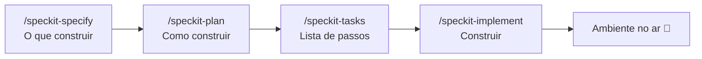

# 🛤️ Golden Path

**Descreva o que você quer. A IA constrói do jeito certo, na primeira vez.**

O Golden Path é um repositório que ensina a IA a criar aplicações com o padrão da casa: mesma stack, mesmas regras, mesmo ambiente. Você não precisa ser desenvolvedor. Conversa em português, aprova cada etapa e vê a aplicação rodando no seu computador.

```text
 💬 Você descreve        📋 A IA especifica       🏗️ A IA planeja        ✅ A IA constrói
 "quero uma lista   →    o que será feito    →    como será feito   →   e sobe tudo no ar
  de tarefas"            (você aprova)            (você aprova)         em http://localhost:3000
```

---

## ✨ Por que existe

| Sem o Golden Path | Com o Golden Path |
|---|---|
| Cada app nasce com uma stack diferente | Stack padrão: React, Node e PostgreSQL |
| "Funciona na minha máquina" | Tudo roda em Docker, igual para todo mundo |
| A IA improvisa e muda de ideia no meio | A IA segue guias e passos escritos pelo time |
| Código antes de entender o pedido | Especificação aprovada antes de qualquer código |
| Medo de apagar o banco sem querer | Comandos perigosos exigem confirmação explícita |

---

## 🚀 Começando em 3 minutos

**Você precisa de:** [Docker Desktop](https://www.docker.com/products/docker-desktop/) instalado e aberto, e o [Claude Code](https://docs.anthropic.com/en/docs/claude-code/setup).

1. Abra este projeto no Claude Code.
2. Digite `/subir-ambiente`.
3. Acesse a tela em **http://localhost:3000** e a API em **http://localhost:4000/health/ready**.

Para desligar sem perder os dados: `/parar-ambiente`.

---

## 🧭 Como criar algo novo

Toda aplicação ou funcionalidade nova passa pelo **Spec Kit**, na ordem abaixo. Você aprova cada etapa antes de a IA seguir.



Você não precisa decorar os comandos: se não digitar nenhum, a IA conduz o fluxo sozinha. Detalhes em [SPECKIT.md](SPECKIT.md).

Só correções pequenas (um texto, uma cor, um bug simples) podem ser pedidas direto.

---

## 🧱 O que vem de fábrica

```text
golden-path/
├── frontend/react/      Tela: React + Vite + Tailwind
├── backend/node/        API: Node.js + TypeScript + Prisma (há também guia para Python, sem esqueleto)
├── database/postgres/   Banco: PostgreSQL com migrations
├── infrastructure/docker/  Docker Compose e guias de ambiente
├── templates/           Cópias dos modelos (geradas; não edite)
├── scripts/             Verificações e sincronização dos templates
├── specs/               Especificações de cada funcionalidade
└── .specify/            Regras do projeto (constituição) e Spec Kit
```

Cada pasta traz um **guia** (as regras daquela tecnologia) e **skills** (o passo a passo de cada tarefa). A IA lê só o que o pedido exige.

| Quero... | A IA abre |
|---|---|
| Uma tela | [frontend/FRONTEND.MD](frontend/FRONTEND.MD) |
| Um endpoint | [backend/BACKEND.md](backend/BACKEND.md) |
| Uma tabela | [database/DATABASE.md](database/DATABASE.md) |
| Rodar o ambiente | [infrastructure/docker/DOCKER.md](infrastructure/docker/DOCKER.md) |

---

## 📅 Escala (módulo M4)

Primeira funcionalidade construída sobre o Golden Path: cadastro por planilha, diagnóstico da escala frente às regras de 42h e 40h (EC 141/2026), grade da semana, simulações, comparação e aprovação. Especificação, plano e tarefas em [specs/001-escala](specs/001-escala/).

- **Cadastros:** baixe a planilha modelo, preencha e importe. O horário da loja é cadastrado dia a dia (segunda a domingo: aberta ou fechada, abertura e fechamento, ou 24 horas) e há o atalho "Loja 24 horas". Planilhas antigas, com só semana, sábado e domingo, continuam sendo entendidas. Planilhas fora do modelo também funcionam: o sistema sugere o que entendeu de cada coluna e só grava depois da sua confirmação.
- **Escala:** envie a escala atual e as vendas por hora, veja o diagnóstico, monte simulações arrastando os turnos, compare até 3 e aprove a que fica em uso (só o dono do grupo aprova).
- **Vagas e custo:** na simulação em rascunho dá para adicionar vagas simuladas e desligamentos (nada chega ao cadastro). O dono informa o salário médio por função e os encargos em Configuração, e a comparação mostra custo mensal, anual e a diferença frente à simulação em uso. Gestor e consulta não recebem valor de custo.
- **Cenários de decisão:** abaixo do quadro central do Diagnóstico há três cenários, para 42h ou 40h (o seletor do quadro troca os três): **1 · Manter horários** (quanto contratar por cargo, ociosidade, custo adicional), **2 · Foco em economia** (quantas horas reduzir, novo horário e a venda e margem que deixam de entrar) e **3 · Equilíbrio** (só fecha as horas que não se pagam e contrata o resto). O dono vê o custo, o impacto por mês e o selo "Menor impacto financeiro"; gestor e consulta não recebem valor de custo. São estimativas: nada altera o cadastro nem cria funcionário. Especificação em [specs/005-cenarios-diagnostico](specs/005-cenarios-diagnostico/).
- **Gerenciar (ponto):** com uma simulação em uso, importe os arquivos de ponto (AFD, Portaria 671/2021). O sistema casa loja e pessoas, deixa as batidas sem correspondência numa fila de pendências e compara planejado × realizado (atraso, falta, hora extra, aderência e cobertura), sempre rotulado como apuração gerencial. O painel avisa quando a simulação em uso está desatualizada. Layout do arquivo conferido em [specs/003-ponto-afd/layout-afd.md](specs/003-ponto-afd/layout-afd.md).
- **Dados de exemplo (fictícios):** `docker compose exec api npm run seed` (só roda se ainda não houver lojas); `docker compose exec api npm run afd:exemplo` gera dois arquivos de ponto fictícios em `backend/node/afd-exemplo/`.
- **Pendências conhecidas:** valores das regras 42h/40h sem validação jurídica; sem login real (há um seletor de papel de demonstração); só dados fictícios até o parecer de proteção de dados (LGPD); ausências, trocas de turno e vendas reais ainda não entram na apuração do ponto; layout antigo de AFD (por PIS) fora; turno que atravessa a meia-noite é montado como dois turnos (um até 24:00 e outro a partir de 00:00); feriados e horários especiais por data não existem; os cenários não viram simulação com um clique e cortam só as pontas do dia (não abrem buraco no meio do horário).

---

## 🛡️ Regras que protegem você

As regras ficam na [constituição do projeto](.specify/memory/constitution.md). As principais:

- **Spec Kit obrigatório** para app e funcionalidade nova.
- **Tudo em Docker**: nada para instalar além do Docker Desktop. As portas só aceitam conexões do seu computador.
- **Banco só muda por migration**, nunca na mão.
- **Dados protegidos**: `docker compose down -v` e similares só rodam com sua confirmação.
- **Segredos fora do git**: senhas ficam no `.env`, que nunca é versionado.
- **Linguagem simples**: a IA explica sem jargão e executa os comandos por você.

---

## 🔧 Algo deu errado?

| Sintoma | O que fazer |
|---|---|
| "Docker não está rodando" | Abra o Docker Desktop e aguarde ~30s |
| Porta ocupada | Mude `WEB_PORT`, `API_PORT` ou `POSTGRES_PORT` no `.env` |
| Tela em branco | Peça à IA: "veja os logs do serviço `web`" |

Na dúvida, descreva o problema para a IA. Ela sabe diagnosticar o ambiente.

---

## 🤝 Contribuindo

Antes de abrir PR, rode `scripts/check-repo.sh` (a CI roda o mesmo e sobe o ambiente de verdade). Quer ensinar um novo padrão? Adicione um guia e uma skill na pasta da tecnologia e registre no [AGENTS.md](AGENTS.md). Mudanças nas regras gerais passam pela [constituição](.specify/memory/constitution.md).
