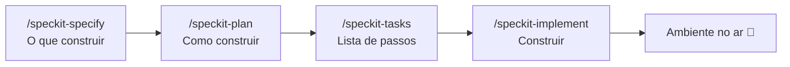

# 🛤️ Golden Path

**Descreva o que você quer. A IA constrói do jeito certo, na primeira vez.**

O Golden Path é um repositório que ensina a IA a criar aplicações com o padrão da casa: mesma stack, mesmas regras, mesmo ambiente. Você não precisa ser desenvolvedor. Conversa em português, aprova cada etapa e vê a aplicação rodando no seu computador.

```text
 💬 Você descreve        📋 A IA especifica       🏗️ A IA planeja        ✅ A IA constrói
 "quero uma lista   →    o que será feito    →    como será feito   →   e sobe tudo no ar
  de tarefas"            (você aprova)            (você aprova)         em http://localhost:3000
```

---

## ✨ Por que existe

| Sem o Golden Path | Com o Golden Path |
|---|---|
| Cada app nasce com uma stack diferente | Stack padrão: React, Node e PostgreSQL |
| "Funciona na minha máquina" | Tudo roda em Docker, igual para todo mundo |
| A IA improvisa e muda de ideia no meio | A IA segue guias e passos escritos pelo time |
| Código antes de entender o pedido | Especificação aprovada antes de qualquer código |
| Medo de apagar o banco sem querer | Comandos perigosos exigem confirmação explícita |

---

## 🚀 Começando em 3 minutos

**Você precisa de:** [Docker Desktop](https://www.docker.com/products/docker-desktop/) instalado e aberto, e o [Claude Code](https://docs.anthropic.com/en/docs/claude-code/setup).

1. Abra este projeto no Claude Code.
2. Digite `/subir-ambiente`.
3. Acesse a tela em **http://localhost:3000** e a API em **http://localhost:4000/health/ready**.

Para desligar sem perder os dados: `/parar-ambiente`.

---

## 🧭 Como criar algo novo

Toda aplicação ou funcionalidade nova passa pelo **Spec Kit**, na ordem abaixo. Você aprova cada etapa antes de a IA seguir.



Você não precisa decorar os comandos: se não digitar nenhum, a IA conduz o fluxo sozinha. Detalhes em [SPECKIT.md](SPECKIT.md).

Só correções pequenas (um texto, uma cor, um bug simples) podem ser pedidas direto.

---

## 🧱 O que vem de fábrica

```text
golden-path/
├── frontend/react/      Tela: React + Vite + Tailwind
├── backend/node/        API: Node.js + TypeScript + Prisma (há também guia para Python, sem esqueleto)
├── database/postgres/   Banco: PostgreSQL com migrations
├── infrastructure/docker/  Docker Compose e guias de ambiente
├── templates/           Cópias dos modelos (geradas; não edite)
├── scripts/             Verificações e sincronização dos templates
├── specs/               Especificações de cada funcionalidade
└── .specify/            Regras do projeto (constituição) e Spec Kit
```

Cada pasta traz um **guia** (as regras daquela tecnologia) e **skills** (o passo a passo de cada tarefa). A IA lê só o que o pedido exige.

| Quero... | A IA abre |
|---|---|
| Uma tela | [frontend/FRONTEND.MD](frontend/FRONTEND.MD) |
| Um endpoint | [backend/BACKEND.md](backend/BACKEND.md) |
| Uma tabela | [database/DATABASE.md](database/DATABASE.md) |
| Rodar o ambiente | [infrastructure/docker/DOCKER.md](infrastructure/docker/DOCKER.md) |

---

## 📅 Escala (módulo M4)

Primeira funcionalidade construída sobre o Golden Path: cadastro por planilha, diagnóstico da escala frente às regras de 42h e 40h (EC 141/2026), grade da semana, simulações, comparação e aprovação. Especificação, plano e tarefas em [specs/001-escala](specs/001-escala/).

- **Cadastros:** baixe a planilha modelo, preencha e importe. O horário da loja é cadastrado dia a dia (segunda a domingo: aberta ou fechada, abertura e fechamento, ou 24 horas) e há o atalho "Loja 24 horas". Planilhas antigas, com só semana, sábado e domingo, continuam sendo entendidas. Planilhas fora do modelo também funcionam: o sistema sugere o que entendeu de cada coluna e só grava depois da sua confirmação.
- **Loja completa em um só lugar:** a configuração da loja tem nome, CNPJ (validado), cidade, UF, bandeira, regime tributário (Simples Nacional, Lucro Presumido ou Lucro Real, só informativo) e o horário dia a dia. O dono também informa o **faturamento médio** de cada dia da semana, o mensal e a margem bruta média; gestor e consulta nem recebem esses valores. Ao editar uma loja, a **equipe** aparece abaixo, com busca por nome ou cargo, e dá para adicionar, editar e remover funcionários ali mesmo: nome, matrícula, cargo, função de escala, CPF (validado, único na loja e mascarado para quem só consulta), carga mensal (220 h = 44 h por semana, 210 h = 42 h, 200 h = 40 h) e horário de entrada e saída atuais com os dias trabalhados.
- **Venda do Diagnóstico sem base comercial:** a base comercial é opcional. Sem ela, o Diagnóstico usa o faturamento cadastrado na loja, dividido igualmente entre as horas abertas de cada dia, e avisa que é estimativa (não há "horário de maior venda" nesse caso). Com a base, ela vale no lugar do cadastro. O horário digitado no cadastro da equipe completa a escala atual de quem não está na escala importada; a escala importada sempre vale mais.
- **Escala:** envie a escala atual e as vendas por hora, veja o diagnóstico, monte simulações arrastando os turnos, compare até 3 e aprove a que fica em uso (só o dono do grupo aprova).
- **Vagas e custo:** na simulação em rascunho dá para adicionar vagas simuladas e desligamentos (nada chega ao cadastro). O dono informa o salário médio por função e os encargos em Configuração, e a comparação mostra custo mensal, anual e a diferença frente à simulação em uso. Gestor e consulta não recebem valor de custo.
- **Cenários de decisão:** abaixo do quadro central do Diagnóstico há cinco cenários, para 42h ou 40h (o seletor do quadro troca todos): **1 · Manter horários**, **2 · Foco em economia**, **3 · Equilíbrio**, **4 · Abrir um dia hoje fechado** e **5 · Reduzir equipe** (quantas pessoas por cargo excedem o que o horário atual exige, com a economia de folha, como capacidade excedente para a gestão avaliar, sem validação trabalhista). O dono vê o custo, o impacto por mês e o selo "Menor impacto financeiro" (entre os cenários 1 a 3); gestor e consulta não recebem valor em reais. São estimativas: nada altera o cadastro nem cria funcionário. Os cenários 4 e 5 não entram no selo. Detalhes do cálculo no item seguinte.
- **Cadastros reúne o que a Escala precisa para simular:** duas seções: "Lojas" (o painel de Cadastro de loja, descrito abaixo) e "Parâmetros legais" (regras de 44h, 42h e 40h com versões). A Escala fica só com "Diagnóstico" e "Simulações".
- **Importação em massa (spec 014):** a tela **Cadastro de Loja** tem um só botão, **Importar em massa**. Ele abre o modal com o botão "Baixar planilha modelo" e o envio do arquivo (.xlsx ou .csv); antes de gravar, o sistema mostra o que entendeu das colunas. O modelo tem duas abas para preencher: **Lojas** (dados, horário por dia, loja 24 horas, faturamento e margem, convenção de 8h24, meta de pessoas por hora de cada função, salário médio por função e encargos) e **Funcionários** (dados da equipe e **Horário fixo**), mais a aba de ajuda "Como preencher". Cada campo do cadastro de loja e de funcionário tem uma coluna no modelo. **Quem importa o quê:** o operador cria e atualiza lojas; o dono atualiza as lojas que já existem (horário, faturamento, margem, convenção, metas e custos), mas não cria loja nem muda código ou CNPJ; o gestor importa só a equipe (a aba Lojas é ignorada com aviso). Faturamento, margem, salário e encargos só o dono grava. **Coluna em branco mantém o que já está cadastrado** (vazio nunca apaga) e planilhas antigas, sem as colunas novas, continuam funcionando. Metas e salários são mesclados com o que a loja já tem; salário sem encargos não grava custo e o resumo avisa. O resumo mostra criados, atualizados, avisos e as linhas com erro (aba, linha e motivo). Especificação em [specs/014-importacao-em-massa](specs/014-importacao-em-massa/).
- **Encargos da folha por regime tributário (spec 015):** o encargo não é mais um percentual digitado: vem do **regime tributário da loja** (Simples Nacional, Lucro Presumido ou Lucro Real). Cada regime guarda os componentes (INSS patronal, RAT × FAP, terceiros, FGTS, 13º, férias + 1/3 e, se ligada, a provisão de rescisão) e o total é calculado: `diretos + provisões + (provisões × diretos) + rescisão`. Com os padrões, o Simples dá cerca de 29,0% e o Presumido e o Real cerca de 62,2% (Real e Presumido têm os mesmos encargos de folha). O total vale na folha atual, no custo das contratações, na hora extra, nos cenários e nas simulações. Os componentes ficam em **Parâmetros legais › Encargos por regime**, com data de início de vigência e versões (só o dono altera; alterar cria uma versão nova). Loja **sem regime** usa o Lucro Presumido e mostra o alerta "Não encontramos o regime tributário da loja…", com o seletor para escolher o regime na hora. Em **Custos** o dono ajusta, por loja, **RAT** (1% a 3%), **FAP** (0,5 a 2,0) e a **provisão de rescisão**, com "Restaurar padrão"; o card da folha mostra "Salários + encargos {total}% ({regime})" e "Ver composição". Na planilha de importação, a coluna "Encargos (%)" foi trocada por "RAT (%)", "FAP" e "Provisão de rescisão (Sim/Não)"; a coluna antiga ainda é lida, mas ignorada com aviso. Percentuais de referência: confirme com seu contador. Antes e depois da folha em [specs/015-encargos-por-regime/antes-depois-folha.md](specs/015-encargos-por-regime/antes-depois-folha.md).
- **Card "Diagnóstico da escala" (versão compacta):** no topo da aba Diagnóstico, as abas **Regra de 44h / 42h / 40h** (com "em vigor hoje" e a data de início) trocam o card inteiro. O card responde primeiro à pergunta "quanto falta de farmacêutico e o que faço?": pill de status, título ("Faltam 14h de farmacêutico por semana"), texto de apoio com o prazo ("daqui a 47 dias", ou em meses acima de 60 dias, pela data em São Paulo), três barras que comparam o gap de 44h, 42h e 40h, e quatro números de apoio (contratações sugeridas, turnos de farmacêutico a cobrir, a **folha mensal atual** com os encargos do regime, e a equipe toda; a composição dos encargos aparece numa dica "i" no quadro da folha, ao passar o mouse, focar com o teclado ou tocar). No rodapé ficam as pendências (colaborador sem função de escala, horas sem farmacêutico, abaixo da meta, linhas rejeitadas) e o link para enviar a base comercial; sem pendências aparece a frase "Sem pendências em cobertura, metas e importação.". Cinco estados: falta na regra em vigor, falta numa regra futura, cobertura completa, sem cálculo e regra já em vigor. As abas funcionam com as setas do teclado. Os cinco cartões de "Pontos de atenção" saíram: os valores continuam como dica na frase do rodapé.
- **Cadastro de loja em painel único (spec 017):** uma tela só, com a **lista de lojas** à esquerda (busca por nome, código ou CNPJ; filtros "Cadastro: Completo/Revisar" e "UF"; "Ver mais"; seleção por clique ou setas) e a **loja escolhida** à direita, em 3 abas, no mesmo cartão. Abaixo de ~1100 px viram duas telas, com "← Voltar para a lista". A loja e a aba ficam no endereço (`?tela=cadastros&loja=…&aba=…`; nada sensível), então recarregar volta ao mesmo lugar. **Completo ou Revisar** é calculado no servidor (`situacaoDoCadastro`, uma função só): dados básicos (nome, cidade, UF, regime), funcionamento definido, ao menos 1 farmacêutico, faturamento em todos os dias abertos e mensal dentro de 10% da soma dos dias; o detalhe mostra o motivo em texto, sem valores em reais. **Dados e funcionamento:** dados da loja e uma tabela com uma linha por dia (aberta/fechada, abre, fecha, 24h, faturamento médio só para o dono, horas), "Loja 24 horas", "Copiar horário da segunda" (só o horário) e o resumo por mês (mensal informado, soma dos dias × 52 ÷ 12, margem) com o alerta de 10% e "Usar R$ …". **Equipe:** cada ação grava na hora (aviso, remover com confirmação e "Desfazer"), CPF mascarado, "Fora do cálculo", "Importar equipe". **Regras e custos:** custos e encargos recolhidos (só o dono), convenção com a chave "Não permite / Permite" e o **Mínimo de pessoas** por turnos (barra com sobreposição e faixas fora do horário, cartões de turno, farmacêutico sempre ≥ 1) ou mínimo único do dia; trocar de modo não apaga o outro. **Um só "Salvar alterações"** grava dados, funcionamento, faturamento, regras e custos de uma vez (`PUT /lojas/:id/painel`: valida tudo antes e grava numa única atualização), com contador de alterações, "Cancelar" e aviso ao sair com alterações. O operador cadastra loja pelo modo "Nova loja" (Equipe e Regras ficam bloqueadas até a primeira gravação). **Regras novas de turno no servidor:** turnos podem se sobrepor e começar antes da abertura ou terminar depois do fechamento; o mínimo só conta dentro do horário de funcionamento; onde dois turnos se sobrepõem vale o **maior** mínimo por cargo (não soma); horas sem turno viram aviso ("Sem turno entre 17:00 e 18:00", valendo 1 farmacêutico e o nível de hoje nos demais), não erro; o modo "turnos" ou "único" fica guardado no JSON de turnos (sem migration). Fora do desenho novo e por isso removidos: o botão "Remover loja" da lista antiga e o formulário "Editar loja" em página inteira. Especificação, plano, tarefas e relatório em [specs/017-cadastro-loja-painel](specs/017-cadastro-loja-painel/).
- **Cenários sugeridos lado a lado (comparação alinhada):** os três cartões usam uma grade com subgrid (a partir de 1200 px), então cada faixa fica na mesma altura nos três: título, pills, descrição, impacto mensal estimado (com a composição "folha adicional + margem perdida" e uma barra proporcional ao maior impacto), frase de comparação com o Cenário 1 ("R$ … a mais por mês que o Cenário 1"), contratações em chips, e as linhas Horário, Horas abertas, Vendas perdidas e Horas ociosas da equipe, com o botão **Personalizar** sempre no pé. As pills são "Cenário sugerido", "Menor impacto mensal" (só quando um cenário é o único menor), o status ("Não resolve sozinho", "Não recomendado", "Inviável") e "Mais cara que manter" (equilíbrio pior que o Cenário 1). **Personalizar** cria um rascunho de simulação a partir da escala atual com as contratações do cenário e abre a aba Simulações; o horário do cenário não vai para o simulador. Abaixo de 1200 px os cartões empilham. Quem não é dono vê tudo menos os valores em reais.
- **Simulação em 3 passos (spec 016):** "Personalizar" abre uma tela com **três passos** e um **painel de resultado** fixo ao lado (abaixo de ~1100 px de conteúdo ele desce para depois do passo 3). Em cima, a barra de parâmetros: Regra (42h | 40h), Horário ("Manter horários" | "Mudar horários"), regime e encargos da loja e "Maior venda". **1 · Horário e vendas:** a lista de horários é só de leitura ("Igual ao Cadastro") ou editável (abertura e fechamento de cada dia, erro em texto e ícone, marca "Alterado", botões − e + (1 hora no fechamento), "Fechar dia"/"Reabrir" e "Restaurar do Cadastro"; nada disso altera o Cadastro, e dias fechados no Cadastro ficam "Fechado"); ao lado, o gráfico de venda (R$, só o dono) ou clientes por hora do dia escolhido, com as horas cortadas em cinza. **2 · Contratações por função:** situação de hoje, contratações simuladas (Integral, Parcial 16h e 24h) com custo, resultado ("Coberto"/"Ainda falta") e total. **3 · Escala da semana:** grade por função com "Ver mais N pessoas"; clicar no dia abre o ajuste por hora. **Painel:** o impacto por mês aparece uma única vez (folha extra + hora extra + margem perdida) com as linhas folha extra, hora extra, venda que sai, margem perdida e horas abertas; sem base comercial ou sem margem, venda e margem que saem aparecem como "Sem dado" (nunca R$ 0). A hora extra é uma **estimativa**: horas que ainda faltam × valor-hora × 1,5 × encargos do regime. **Salvar como cenário N** grava a simulação como "Cenário N" (número por loja) e abre uma cópia para continuar ajustando; **Marcar como em uso** (só o dono) grava e pede a data de início. O resultado é calculado no servidor com o mesmo motor dos cenários; o horário editado fica guardado só na simulação. **Sem escala importada**, o "Personalizar" cria a simulação a partir do quadro do Cadastro (sem turnos) e avisa na tela; contratações, horários e impacto funcionam, e os turnos podem ser montados no ajuste por hora do passo 3. Fora desta entrega: abrir dias fechados ou estimar venda ao abrir mais cedo, desligamentos simulados (saíram da tela) e as marcas do perfil da loja ("Referência em genéricos", "Expansão de horário"), que não existem no sistema. Especificação em [specs/016-simulacao-em-3-passos](specs/016-simulacao-em-3-passos/).
- **Turnos e mínimo por turno:** em Cadastros › Lojas › Editar › Funcionários e configuração, cada loja pode definir até 6 turnos (nome, início e fim) e quantas pessoas de cada cargo exige em cada um (farmacêutico sempre ao menos 1). (Desde a spec 017 os turnos podem se sobrepor e passar do horário da loja; onde se sobrepõem vale o maior mínimo por cargo, e hora sem turno é só aviso); lojas 24 horas aceitam turno que vira a noite. Sem turnos, vale o mínimo único do dia inteiro, com o mesmo resultado de antes. O Diagnóstico, as simulações, o ponto e os cinco cenários usam o mínimo de cada turno (a necessidade soma só as horas em que cada pessoa a mais é exigida) e o **quadro por turno** mostra, por cargo, as pessoas que a loja tem (pior hora do turno, no pior dia) × o mínimo, com a falta destacada e quem ficou fora da conta. A explicação de cada cálculo cita o turno. Especificação em [specs/008-cobertura-por-turno](specs/008-cobertura-por-turno/).
- **Parâmetros legais:** a aba "Parâmetros legais" de Cadastros lista, por fase (44h, 42h e 40h), jornada, horas por dia (e com convenção, 8h24), dias de trabalho e divisor mensal, cada versão com data de início. Só o dono cria uma nova versão (nunca se edita a antiga; há histórico e auditoria); vale a mais recente que já começou e, se todas estão no futuro, a mais antiga. Diagnóstico, cenários, simulações e custo leem essa tabela.
- **Aviso de estimativa:** todo Diagnóstico mostra que o resultado é uma estimativa e deve ser validado com o contador e com a convenção coletiva do sindicato.
- **Cenários de horário por dia, comparativo e premissas:** sem a venda hora a hora, os cenários decidem por **dia da semana**: o **2 · Foco em economia** mexe **só no fim de semana**, nesta ordem: reduz o fechamento de sábado e domingo (de 1 em 1 h, até sobrar 4 h por dia), depois fecha o domingo e por fim o sábado, parando no primeiro passo em que a equipe atual cobre o horário; o **3 · Equilíbrio** testa todas as reduções e fechamentos de fim de semana permitidos (e as contratações de cada um) e escolhe a de menor impacto; **segunda a sexta nunca mudam**; o **4 · Abrir um dia** usa a sobra da equipe do Cenário 1 para abrir um dia hoje fechado, com margem de referência (50% da média dos dias abertos). Os **3 dias de maior faturamento são protegidos**: só reduzem, nunca fecham. As **travas** valem para os cenários 2 e 3: a loja não perde mais de **10% do faturamento** e mantém ao menos **85% das horas abertas** de hoje. Quando uma trava para o Cenário 2 antes de a equipe caber, ele aparece como **"Não resolve sozinho"**, mostrando o corte possível, quanto ainda falta cobrir e a indicação do Cenário 3; sem a margem da loja informada, a margem perdida aparece em branco (nunca R$ 0). Especificação em [specs/012-cenarios-travas-fim-de-semana](specs/012-cenarios-travas-fim-de-semana/). A venda de cada dia vem da base comercial somada por dia da semana, do faturamento por dia do cadastro ou, só com o mensal, de uma estimativa avisada. O **Cenário 1** usa a regra do documento (inteiras = turnos faltantes ÷ dias; resto de até 3 turnos vira contrato parcial; conferência final pelas horas), mostra a contratação em **etapas** (fase de 42h e adicional para a de 40h) e, para o dono, custo por mês e por ano e peso no faturamento. Logo abaixo do quadro do diagnóstico, **três cartões lado a lado** (cenários 1, 2 e 3) mostram, para a regra escolhida, o saldo mensal estimado, as contratações, a folha adicional, o faturamento e a margem perdidos, a mudança de horário, as horas abertas, a ociosidade das contratações e o ganho frente a manter horários, com status (não recomendado, inviável) e alertas; o de menor impacto financeiro vem marcado como "Cenário sugerido". Abaixo deles ficam o detalhe de cada cenário e os cenários 4 e 5. Valores em reais só para o dono. O painel de premissas para simular foi tirado da tela para não confundir; os cálculos usam sempre os valores padrão (recaptura 0%, fator de dia novo 50%, 3 dias protegidos, contrato parcial de até 3 turnos). Especificações em [specs/009-cenarios-por-dia](specs/009-cenarios-por-dia/) e [specs/010-cenario1-turnos-comparativo](specs/010-cenario1-turnos-comparativo/).
- **Farmacêutico obrigatório, metas e contratação por horas (spec 013):** só o **farmacêutico** é mínimo obrigatório: precisa estar presente em todas as horas abertas, todos os dias, e o que falta aparece em **horas por semana** (o gap), com os turnos como apoio. Os demais cargos **não têm mínimo**: a meta é manter o **nível de hoje** (as horas que o cargo cumpre hoje, no teto da regra atual), ou o valor que o dono informar em Cadastros › Lojas › Editar › Funcionários e configuração (campo "Meta (opcional)"). Meta não bloqueia nada, só gera sugestão marcada "meta". A contratação segue a CLT: gap de até **30 h** vira **um contrato parcial** (nunca mais que 30 h); gap maior vira **integral**, ou **integral + parcial** quando isso reduz as horas ociosas; a variante de 26 h + até 6 h extras aparece só como alternativa. A tabela mostra horas contratadas, usadas e ociosas (%), custo mensal (só para o dono) e os **dias e horários do parcial**, nos dias em que ainda falta gente. O parcial de farmacêutico leva o aviso do CRF ("O horário do farmacêutico parcial precisa ser registrado no CRF e não pode coincidir com o horário em que ele atua em outra farmácia"). Antes de contratar, o sistema **redistribui** quem a loja já tem (até 5 dias por pessoa, até 8 h por dia, teto da regra, folga no domingo sempre que possível); quem tem **Horário fixo** no cadastro de funcionário não é remanejado e o diagnóstico avisa. A redistribuição é uma montagem simples, não uma otimização exata. O quadro do Diagnóstico tem uma aba **44h · hoje** ao lado de 42h e 40h: mostra como a loja está na regra atual (quem já está inadequado hoje), com o mesmo quadro central, contratações e escala redistribuída; os cenários de economia e equilíbrio ficam só para 42h e 40h. O parâmetro de consulta `limiteParcial` continua aceito, mas é ignorado. Especificação em [specs/013-farmaceutico-contratacao-por-horas](specs/013-farmaceutico-contratacao-por-horas/).
- **Vários empresários (Grupo Econômico, GE):** cada empresário é um GE e só enxerga as lojas, a equipe, as simulações e os custos do seu grupo; o servidor confere o GE em toda consulta e responde "não encontrado" para qualquer dado de outro grupo. Os dados que já existiam ficam no "Grupo inicial". Quem cuida da plataforma entra como **Operador da plataforma** e usa o menu **Grupos**: cria, edita e desativa GEs, vê quantas lojas cada um já tem com equipe e envia o **Excel de lojas da plataforma** (o relatório com a coluna "Grupo Econômico"). O envio tem duas etapas: confere (nada é gravado) e só grava ao confirmar. Só lojas com status **Ativado** entram; Desativado, Montando e Transição são ignoradas e contadas. A loja é identificada pelo **CNPJ** (único no sistema): reenviar o arquivo atualiza, não duplica, e GEs novos são criados sozinhos (identificação = número do grupo, nome = responsável). O **código da loja é a coluna Id** do relatório (a carga também acerta o código de lojas que já existiam, salvo se outra loja do grupo já usa esse código); CNPJ e código só o operador altera. Se o empresário corrigiu um dado da loja e a plataforma também mudou, aparece como **conflito**: por padrão a correção dele é mantida e o operador escolhe o que substituir. O **empresário** corrige qualquer dado da loja (menos o CNPJ) e cadastra só a equipe; ele não cria nem remove lojas. O operador não vê valores em reais nem o CPF inteiro. O GE e o papel são escolhidos no topo da tela, só para demonstração. Especificação em [specs/011-multitenant-ge](specs/011-multitenant-ge/).
- **Dados de exemplo (fictícios):** `docker compose exec api npm run seed` (só roda se ainda não houver lojas).
- **Pendências conhecidas:** a aba Gerenciar (importação de ponto AFD e apuração planejado × realizado) foi retirada do sistema por não agregar; os dados de ponto que já estavam no banco foram mantidos, sem uso; valores das regras 42h/40h sem validação jurídica; **sem login real: o papel e o GE são escolhidos em tela e, por isso, a separação entre GEs protege contra mistura por engano, mas não contra quem altere o cabeçalho da chamada de propósito; o login por SSO precisa existir antes de usar com dados reais de empresários** (a lista de nomes dos GEs também fica aberta até lá); só dados fictícios até o parecer de proteção de dados (LGPD); turno que atravessa a meia-noite é montado como dois turnos (um até 24:00 e outro a partir de 00:00); feriados e horários especiais por data não existem; os cenários não viram simulação com um clique, cortam e estendem só as pontas do dia (nada no meio do horário), não há folguista como opção de contratação nem visão de rede de lojas, e os percentuais da venda de referência das horas novas são uma suposição, não dado real; a venda estimada pelo faturamento do cadastro supõe vendas iguais em todas as horas abertas (sem a base, os cenários de corte tendem a empatar entre as pontas); horário de funcionário que vira a noite fica só informativo; o regime tributário ainda não entra em nenhum cálculo; os cenários decidem por dia, sem curva de venda por hora (não há corte de pontas nem corte de turno dentro do dia); a recaptura e o fator de dia novo são suposições editáveis; o painel de vendas por hora mostra a participação de cada hora (e não o valor em reais) para gestor e consulta; as simulações salvas leem a tabela de parâmetros de hoje (não guardam um retrato dela); os turnos são os mesmos em todos os dias da semana (recortados pelo horário de cada dia); ainda faltam fator de férias e faltas, custo completo (encargos por regime, provisões, adicionais), cenário de hora extra, adicional noturno, sócio/estagiário/aprendiz e convenções coletivas (ver docs/relatorio-gap-regras-fim-6x1.md).

---

## 🛡️ Regras que protegem você

As regras ficam na [constituição do projeto](.specify/memory/constitution.md). As principais:

- **Spec Kit obrigatório** para app e funcionalidade nova.
- **Tudo em Docker**: nada para instalar além do Docker Desktop. As portas só aceitam conexões do seu computador.
- **Banco só muda por migration**, nunca na mão.
- **Dados protegidos**: `docker compose down -v` e similares só rodam com sua confirmação.
- **Segredos fora do git**: senhas ficam no `.env`, que nunca é versionado.
- **Linguagem simples**: a IA explica sem jargão e executa os comandos por você.

---

## 🔧 Algo deu errado?

| Sintoma | O que fazer |
|---|---|
| "Docker não está rodando" | Abra o Docker Desktop e aguarde ~30s |
| Porta ocupada | Mude `WEB_PORT`, `API_PORT` ou `POSTGRES_PORT` no `.env` |
| Tela em branco | Peça à IA: "veja os logs do serviço `web`" |

Na dúvida, descreva o problema para a IA. Ela sabe diagnosticar o ambiente.

---

## 🤝 Contribuindo

Antes de abrir PR, rode `scripts/check-repo.sh` (a CI roda o mesmo e sobe o ambiente de verdade). Quer ensinar um novo padrão? Adicione um guia e uma skill na pasta da tecnologia e registre no [AGENTS.md](AGENTS.md). Mudanças nas regras gerais passam pela [constituição](.specify/memory/constitution.md).
